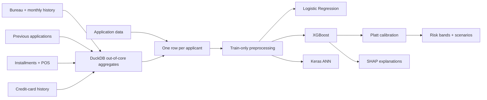

# Credit Risk AI — Explainable Credit Default Risk Decision Support

A machine-learning case study using the Home Credit dataset to rank applicant default risk,
incorporate historical customer behavior, calibrate predicted probabilities, explain predictions
with SHAP, and evaluate business thresholds under different cost assumptions.

## Verified project highlights

- **307,511 applications** across **7 relational data tables**, with **8.07% default prevalence**.
- Logistic Regression, XGBoost, and ANN evaluated on the same held-out validation applicants.
- Primary XGBoost: **ROC-AUC 0.7866**, **PR-AUC 0.2882**, and **F1 0.3070**.
- Recall-oriented ANN comparison: **recall 0.7247**.
- Historical behavior improved XGBoost ROC-AUC **0.7628 → 0.7866** and PR-AUC
  **0.2532 → 0.2882** over application-only modeling.
- Training-only **Platt probability calibration** and validation-derived risk bands.
- SHAP global and anonymized applicant-level explainability.
- Cost-sensitive threshold simulation across multiple hypothetical FN:FP assumptions.
- Lightweight, interactive **five-page Streamlit dashboard**.

> **Important:** This is an educational decision-support demo—not an automated loan approval
> system, lending policy, or production risk model. Hypothetical cost units are not Home Credit,
> bank, or insurance economics.

## Business problem

Credit providers must detect applicants likely to experience payment difficulty while avoiding
unnecessary friction for reliable customers. A false negative can create credit loss; a false
positive can lose revenue and damage the customer relationship. Consequently, this project
evaluates ROC-AUC, PR-AUC, recall, precision, F1, calibration, and operational trade-offs rather
than relying on accuracy alone.

## Dataset

The Home Credit dataset contains a primary application table plus customer histories distributed
across bureau, previous application, installment, POS, and credit-card tables.

- `application_train.csv`: 307,511 applications and 122 columns.
- Payment-difficulty target prevalence: 8.07%.
- 67 application columns contain missing values; 41 exceed 50% missingness.
- No duplicate applicant IDs, duplicate rows, infinite numeric values, or constant application
  columns were detected.

Raw Kaggle CSV/ZIP files live only under `data/raw/` and are excluded from Git.

## Architecture and workflow

> Home Credit relational data
> → leakage-safe customer-level feature engineering
> → Logistic Regression / XGBoost / ANN
> → held-out validation
> → probability calibration
> → SHAP explainability
> → risk bands
> → cost-sensitive decision scenarios
> → Streamlit dashboard



DuckDB scans the multi-GB CSVs out of core and produces compressed per-source aggregates before
joining them to application data. This avoids unnecessary full-table copies in memory.

## Methodology / Leakage prevention

Historical relational records are aggregated to one applicant/customer row without target or
future-outcome information before they are joined to the application table. Learned preprocessing,
models, and calibration remain training-only; the fixed validation applicants are used only for
evaluation.

- A fixed stratified 80/20 split (`random_state=42`) is created before learned preprocessing.
- Every phase reuses the exact 246,008 training and 61,503 validation applicant IDs.
- The applicant identifier is retained only in Git-ignored manifests and never used as a feature.
- Imputation, scaling, and category learning are fitted on training rows only.
- Relational tables are aggregated to applicant grain before joining; the target is absent from
  every relational feature table.
- Calibration uses three-fold out-of-fold predictions generated from training IDs only.
- Artifact hashes verify that later phases do not modify validated earlier results.

## Feature engineering

Phase 2 adds 116 behavioral features to 120 application features:

- Bureau: loan counts, active/closed ratios, credit/debt/overdue amounts, prolongations, and monthly
  delinquency severity.
- Previous applications: approval/refusal/cancellation ratios, requested versus approved amounts,
  terms, recency, and repeat-customer behavior.
- Installments: lateness frequency/days, underpayment frequency/amount, and paid-to-due ratios.
- POS: contract status, days past due, remaining installments, and history length.
- Credit cards: balance-to-limit utilization, drawings, minimum-payment shortfalls, payments, and
  delinquency.

The transformed model matrix grows from 241 Phase 1 features to 357 Phase 2 features.

## Model comparison

All results use the same validation set at the original model threshold of 0.50.

| Phase | Model | ROC-AUC | PR-AUC | Recall | Precision | F1 |
|---|---|---:|---:|---:|---:|---:|
| 1: application only | Logistic Regression | 0.7487 | 0.2279 | 0.6785 | 0.1617 | 0.2612 |
| 1: application only | XGBoost | 0.7628 | 0.2532 | 0.6580 | 0.1762 | 0.2780 |
| 1: application only | ANN | 0.7495 | 0.2275 | 0.7172 | 0.1550 | 0.2549 |
| 2: relational | Logistic Regression | 0.7739 | 0.2601 | 0.6975 | 0.1740 | 0.2785 |
| 2: relational | **XGBoost** | **0.7866** | **0.2882** | 0.6663 | **0.1995** | **0.3070** |
| 2: relational | ANN | 0.7751 | 0.2688 | **0.7247** | 0.1659 | 0.2699 |

Relational history improves XGBoost ROC-AUC from **0.7628 to 0.7866**, PR-AUC from **0.2532 to
0.2882**, and F1 from 0.2780 to 0.3070. XGBoost is the primary decision-support model; ANN remains
the recall-oriented comparison.

## Calibration

Class weighting improves minority-class detection but makes raw XGBoost scores overconfident.
Training-only out-of-fold calibration produced:

| Probability output | Brier score | 10-bin calibration error |
|---|---:|---:|
| Uncalibrated | 0.166011 | 0.282561 |
| **Platt scaling** | **0.065657** | **0.004197** |
| Isotonic regression | 0.065669 | 0.004575 |

Platt scaling is used for probability-facing decision analysis. It preserves XGBoost ranking
metrics while substantially improving probability reliability.

## SHAP explainability

Global SHAP importance identifies External Source 1/2/3, credit and goods amounts, annuity,
installment late ratio, age/employment proxies, prior credit-to-application behavior, POS remaining
installments, previous refusal ratio, and bureau debt-to-credit ratio among the major drivers.
Positive SHAP values push the raw model margin toward higher risk; negative values reduce it.
These are model contributions, not causal explanations.

Anonymized low-, medium-, and high-risk case studies report risk and protective factors without
publishing original applicant IDs.

## Threshold and cost analysis

No universal threshold is claimed. With false-positive cost fixed to one hypothetical unit:

| Assumed FN:FP cost | Cost-minimizing calibrated threshold | Recall | Precision | FP | FN |
|---|---:|---:|---:|---:|---:|
| 2:1 | 0.35689 | 0.1396 | 0.4642 | 800 | 4,272 |
| 5:1 | 0.18443 | 0.4161 | 0.2894 | 5,072 | 2,899 |
| 10:1 | 0.09933 | 0.6753 | 0.1976 | 13,615 | 1,612 |
| 20:1 | 0.05459 | 0.8433 | 0.1414 | 25,434 | 778 |

These costs are illustrative sensitivity assumptions, not measured financial impact.

## Risk bands

Validation decile boundaries were searched for monotonic observed rates and maximum weighted
between-band separation:

| Band | Validation applicants | Calibrated probability | Observed default rate |
|---|---:|---:|---:|
| Low | 43,052 (70%) | ≤ 0.0920 | 3.52% |
| Medium | 12,300 (20%) | 0.0921–0.2008 | 12.72% |
| High | 6,151 (10%) | > 0.2008 | 30.68% |

These descriptive bands must be validated on a future holdout before operational use.

## Demo

The Streamlit app contains five views:

1. Executive overview and data architecture.
2. Anonymized applicant explorer with local SHAP drivers.
3. Portfolio distribution, calibrated scores, performance, and confusion matrix.
4. Interactive hypothetical FN:FP scenario simulator.
5. Model comparison, global SHAP, and calibration evidence.

The app uses a checksum manifest and a **~454 KB** bundle under `app/demo_artifacts/`. It requires
neither the 3.4 GB raw dataset nor model files, processed IDs, secrets, TensorFlow, XGBoost, or SHAP
at runtime. Rebuild the bundle locally with:

```bash
uv run python -m src.export_demo_artifacts
```

### Application preview

The five-page interface is validated at a common laptop viewport. Repository screenshots should
be captured from the final public URL after the first deployment so the README reflects the exact
released build rather than a localhost-only preview.

## Privacy / Public demo

The versionable demo bundle contains only anonymized, precomputed validation examples and
aggregate results. It does **not** publish raw Home Credit data, internal applicant IDs such as
`SK_ID_CURR`, trained model binaries, calibration objects, validation-ID manifests, secrets,
credentials, or `.env` files. A checksum manifest and automated privacy tests enforce this release
boundary.

## Limitations

- The dataset is historical; age and domain shift may reduce performance for another lender,
  insurer, geography, population, or economic regime.
- The 8.07% default prevalence creates substantial class imbalance and makes accuracy unsuitable
  as a standalone metric.
- The random split does not test temporal, geographic, or economic-regime drift.
- External source variables are anonymized and cannot support complete policy interpretation.
- Validation-derived calibration and risk bands require future temporal/independent holdout
  confirmation and ongoing monitoring.
- Business costs are hypothetical sensitivity assumptions, not measured Home Credit, bank,
  insurance, LGD, or customer-lifetime-value economics.
- Fairness, adverse impact, stability, privacy, model-risk governance, and jurisdiction-specific
  regulatory review are incomplete.
- SHAP describes model behavior, not causality or applicant deservingness.
- This is not an automated lending approval system or production-ready underwriting model.
  Production decisions require verified economics, affordability rules, human oversight, appeals,
  and formal validation.

## How to run

### Lightweight public demo

Python 3.11 or 3.12 is recommended.

```bash
uv sync --locked --no-dev
uv run --no-dev streamlit run streamlit_app.py --server.port 8501
```

On macOS/Linux, activate with `source .venv-demo/bin/activate`.

The app opens at `http://localhost:8501`. It needs no secrets, raw dataset, or model files.

### Streamlit Community Cloud

Push the reviewed repository, create a public app at
[share.streamlit.io](https://share.streamlit.io/), select the repository and branch, set the main
file to `streamlit_app.py`, select Python 3.12, and leave Secrets empty. Community Cloud installs
the locked default environment from `uv.lock`; analytical libraries are isolated in the optional
`analysis` extra. See [`DEPLOYMENT.md`](DEPLOYMENT.md) for the release checklist and
post-deployment validation.

### Full analytical pipeline

Place the Home Credit files in `data/raw/`, then:

```bash
uv sync --locked --extra analysis
uv run python -m src.audit_data
uv run python -m src.train_baselines
uv run python -m src.build_relational_features
uv run python -m src.train_phase2
uv run python -m src.phase3_analysis
uv run python -m src.export_demo_artifacts
uv run pytest -q
```

## Repository structure

```text
credit-risk-ai/
├── .streamlit/config.toml # Versioned financial-services theme
├── app/demo_artifacts/   # Versionable anonymous public-demo bundle
├── app_pages/            # Streamlit page scripts
├── app_utils/            # Tested UI data/domain/chart helpers
├── data/raw/             # Kaggle data; Git-ignored
├── data/processed/       # Generated features/predictions/IDs; Git-ignored
├── models/               # Trained models/calibrators; Git-ignored
├── reports/              # Versionable metrics, reports, and figures
├── src/                  # Audit, training, feature, calibration, export pipelines
├── tests/                # Unit, artifact, and Streamlit smoke tests
├── streamlit_app.py      # Public demo entrypoint
├── DEPLOYMENT.md
├── pyproject.toml         # Minimal app runtime + optional analysis extra
└── uv.lock                # Reproducible dependency resolution
```

Detailed analytical reports are available in
[`reports/phase2_results.md`](reports/phase2_results.md) and
[`reports/phase3_report.md`](reports/phase3_report.md).
